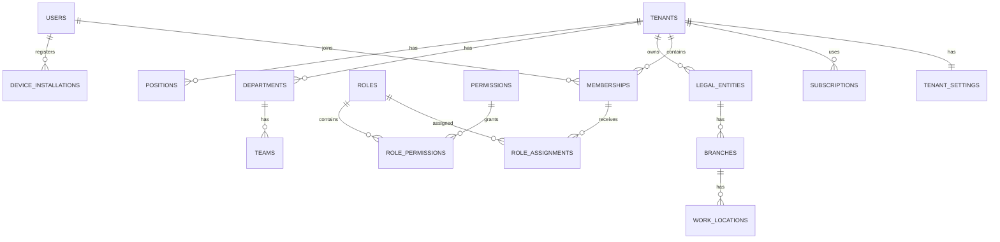
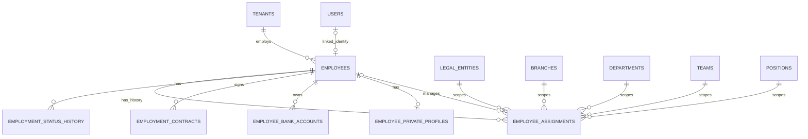
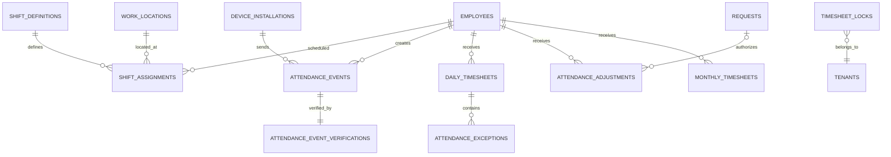
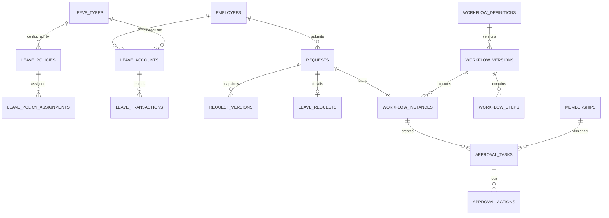
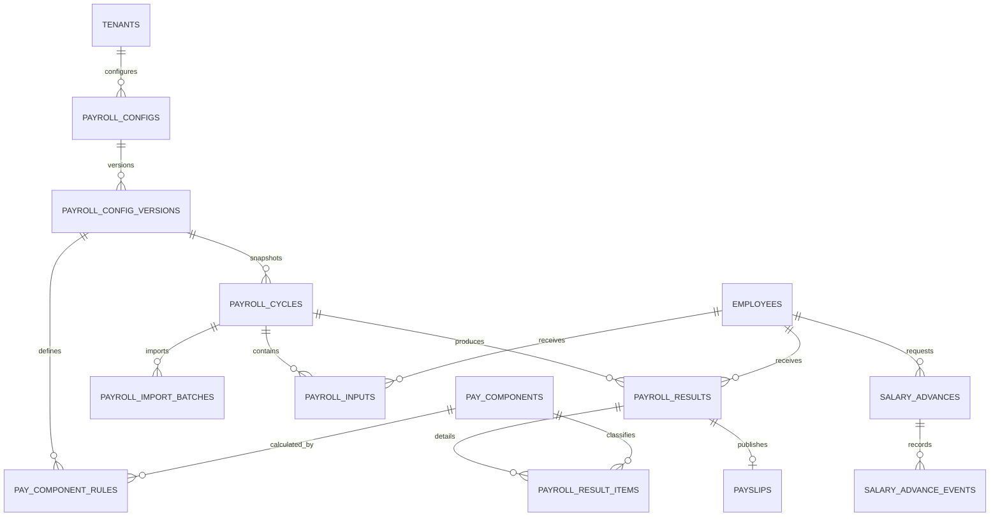
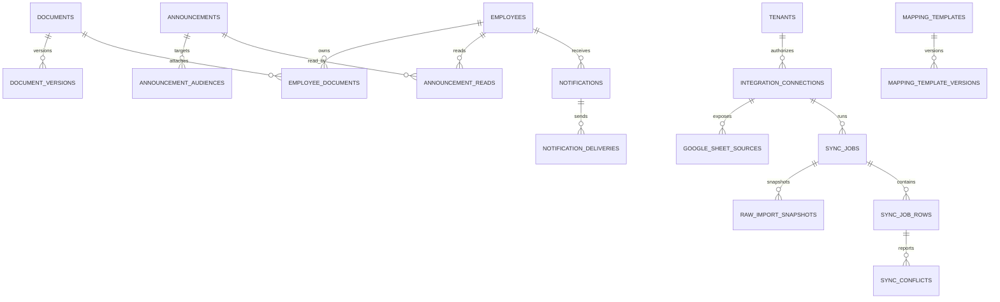
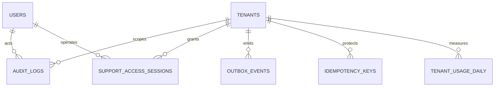

# Kavor HRM — ERD cấp cao

> Phiên bản: 1.0  
> Phạm vi: MVP multi-tenant  
> Chi tiết cột và constraint: xem `DATABASE_SCHEMA.md`

## 1. Tenant, identity và organization

## 2. Employee master

## 3. Attendance

## 4. Leave và workflow

## 5. Payroll

## 6. Documents, communication và integration

## 7. Audit và platform support

## 8. Cardinality và integrity quan trọng

- Một user có thể thuộc nhiều tenant qua memberships.
- Một employee thuộc đúng một tenant và có thể chưa liên kết user.
- Một employee có nhiều assignment lịch sử nhưng chỉ một assignment chính hiệu lực nếu tenant không cho phép kiêm nhiệm.
- Attendance event là immutable; adjustment tham chiếu request khi có.
- Leave balance được suy ra từ transactions, không phải một con số chỉnh tay.
- Request giữ nhiều version và chỉ một workflow instance active.
- Payroll cycle tham chiếu đúng một config version snapshot.
- Payslip tham chiếu payroll result và document version.
- Support access không làm thay đổi membership tenant.

## 9. Unique constraint tối thiểu

- `tenants(code)`.
- `memberships(tenant_id, user_id)` cho membership active.
- `employees(tenant_id, employee_code)`.
- `departments(tenant_id, code)`.
- `positions(tenant_id, code)`.
- `attendance_events(tenant_id, idempotency_key)`.
- `requests(tenant_id, request_no)`.
- `payroll_cycles(tenant_id, cycle_code)`.
- `payroll_results(tenant_id, payroll_cycle_id, employee_id)`.
- `sync_jobs(tenant_id, idempotency_key)` khi key có giá trị.

## 10. Ranh giới bảo mật

- RLS kiểm tra `tenant_id` trên mọi bảng tenant-scoped.
- Employee/Manager/HR/Payroll áp thêm scope theo `PERMISSION_MATRIX.md`.
- Platform Operator không tự động vượt RLS tenant.
- Support chỉ truy cập thông qua session tạm thời đúng tenant/scope.
- Service-role key chỉ tồn tại ở backend/worker, không nằm trong web/mobile.
